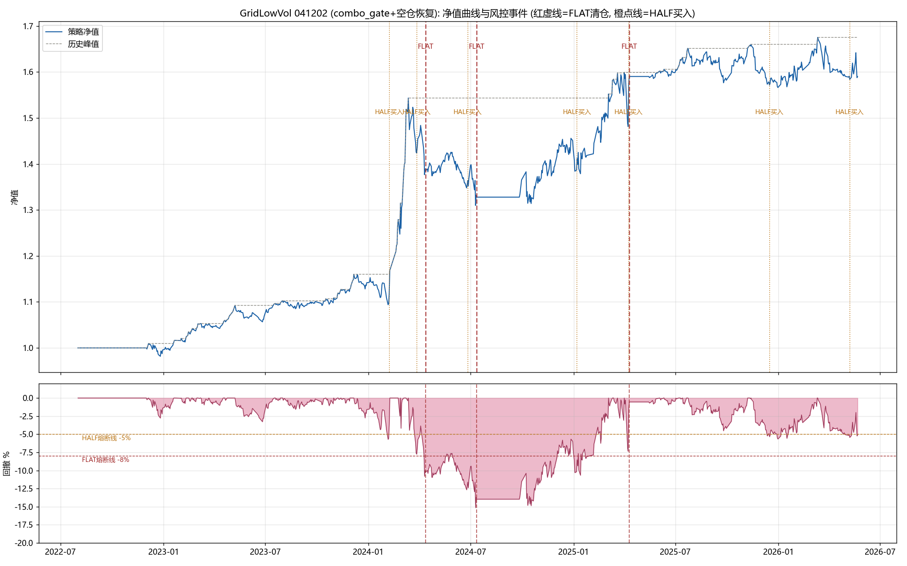

# GridLowVol 组合风控回测深度分析（041202：P0+P1+空仓恢复，all 模式）

- 回测目录: `results/GridLowVol_20220801_20260522_20260822041202`
- 区间: 2022-08-01 ~ 2026-05-22（921 交易日）| 基准: 沪深300(sh.000300)
- 配置: combo_gate 开启（dd_half=5% / dd_flat=8% / dd_recover_full=1.5% / trend_confirm_days=3）
  + 空仓恢复（市场信号重新入场 + 峰值重置，2026-08-22 死锁修复版）
- 分析日期: 2026-08-22

---

## 1. 执行摘要

| 结论 | 一句话 |
|---|---|
| ✅ 绩效大幅提升 | **+58.98%**（年化 13.52%）、Sharpe **1.00**，均创 grid_lowvol 历史最佳 |
| ✅ 归因全面转正 | Active 超额 **+26.81%**（vs 优化版 +6.93%），特质 alpha 从 -5.9pp **转正 +9.2pp** |
| ⚠️ 回撤加深 | 最大回撤 **-15.13%**（2024-07-10），比优化版 -12.04% 加深 3pp |
| 🔴 重大缺陷 | **HALF 熔断语义反转**：6 次 HALF 触发 5 次**买入**（合计 2.86 亿），风控降仓变成抄底加仓 |
| 🔴 恢复过快 | 2024-04-12 FLAT 清仓后 **1 个交易日（4/15）即半仓买回、4/18 满仓**，空仓避险失效 |
| 🟡 预警换手 | 预警清仓 138 次（11.7 亿），交易成本升至 4.52% |

---

## 2. 绩效全景

### 2.1 三代回测对比

| 指标 | 02000509 (P0+P1 重构) | 021954 (all 优化版) | **041202 (combo+recover)** |
|---|---|---|---|
| 总收益 | +21.70% | +39.59% | **+58.98%** |
| 年化 | 5.52% | 9.56% | **13.52%** |
| Sharpe | 0.83 | 0.78 | **1.00** |
| 最大回撤 | -6.40% | -12.04% | **-15.13%** |
| 年化波动 | 6.64% | 12.29% | 13.58% |
| 平均仓位 | — | 68.5% | **52.9%** |
| 空仓天数 | 45 | 0 | **159（17.3%）** |
| 分红 | 314 万 | 740 万 | 610 万 |
| 交易成本 | 308 万 | 440 万 | 452 万 (4.52%) |
| 网格买卖比 | 0.79 | 0.92 | 0.94 |
| 预警清仓 | 186 次 | 0 次 | **138 次** |

> 仓位 68.5%→52.9%：combo 风控主动降仓/空仓所致；空仓 159 天中 2022-2023 防御性低仓为主。

### 2.2 分年度

| 年份 | 收益 | 最大回撤 | 平均仓位 |
|---|---|---|---|
| 2022 | -0.45% | -2.77% | 12.3% |
| 2023 | +14.49% | -3.27% | 41.5% |
| 2024 | **+25.34%** | **-15.13%** | 53.9% |
| 2025 | +11.19% | -7.36% | 72.8% |
| 2026 | +1.07% | -5.44% | 74.1% |

> 2022-2023 低仓位：沪深300 长期 < MA60 → 组合趋势闸门（TREND_DOWN）锁仓。2022-08-01 至 12-02 首笔建仓前**空仓 4 个月**（躲过 2022 下半年 -15% 下跌，防御有效但代价是全年 -0.45% 与 12.3% 仓位）；2023 年低仓 41.5% 却 +14.49%（躲过沪深300 -11%，超额显著）。

### 2.3 净值曲线与风控事件

---

## 3. 收益归因分析（BARRA，基准上证综指）

### 3.1 因子贡献（Carino 复合口径）

| 因子 | 算术累计(bp) | Carino 贡献 | 占 Active | 平均暴露 | vs 021954 |
|---|---|---|---|---|---|
| 波动率 | +1202 | **+13.70%** | 51.1% | -0.253 | +11.44pp → 13.70pp |
| 特质/alpha | +1016 | **+9.19%** | 34.3% | — | **-5.9pp → +9.2pp（转正）** |
| 规模 | +284 | +2.79% | 10.4% | -0.819 | +4.17pp → 2.79pp |
| 动量 | +193 | +1.96% | 7.3% | -0.067 | ~0 → +1.96pp |
| Beta | +194 | +1.70% | 6.3% | -0.301 | ~0 → +1.70pp |
| 价值 | -208 | **-2.53%** | -9.5% | +0.583 | -3.17pp → -2.53pp（暴露 0.811→0.583 收敛） |
| **Active 合计** | **2680** | **+26.81%** | 100% | — | +6.93% → **+26.81%** |

### 3.2 关键解读

1. **波动率因子 +13.70%（51%）持续为核心 alpha**——低波选股 + EGARCH 网格的本源优势，combo 未破坏；
2. **特质 alpha +9.19% 是最大变化**：combo 的择时（回撤熔断空仓、市场信号恢复入场）产生的超额被归入特质。但需警惕——**其中含 combo_half 错误加仓的运气成分**（见 §4.3）；
3. **价值 -2.53% 仍拖累**：暴露 +0.583（收敛但未消除），低波×高价值结构性共线；
4. 规模/Beta/动量均小正贡献，风格组合健康。

---

## 4. combo 风控事件深度剖析

### 4.1 事件时间线（9 次风控动作）

| 日期 | 动作 | 金额 | 当日净值 | 事件背景 | 后续表现 |
|---|---|---|---|---|---|
| 2024-02-07 | HALF **买入** | 8111 万 | 1.1177 | 2/5 微盘危机低点后反弹 | 2/21 卖出 +3~4%（吃反弹） |
| 2024-03-27 | HALF 卖 676 万/买 675 万 | 1351 万 | 1.4236 | dd>5% | 4/12 FLAT 前基本平 |
| 2024-04-12 | **FLAT 清仓** | 11835 万 | 1.3855 | dd=-10.2% | **4/15 半仓买回、4/18 满仓（空仓仅 1 日）** |
| 2024-06-26 | HALF **买入** | 6424 万 | 1.3642 | 6 月阴跌 | 600395 **-7%**，助推最大回撤 |
| 2024-07-12 | **FLAT 清仓** | 13000 万 | 1.3278 | 回撤加深 | 空仓 52 日（至 9/27），踏空 -1.6pp |
| 2025-01-07 | HALF **买入** | 5623 万 | 1.4116 | 1 月调整 | 3/4 卖出 **+10%（+562 万）** |
| 2025-04-09/10 | HALF 买 309 万 → **FLAT 清仓** | 15921 万 | 1.5901 | 4/7 关税冲击 | 空仓 21 日，踏空 **-4.6pp** |
| 2025-12-16 | HALF **买入** | 1099 万 | 1.5714 | 12 月调整 | 601009 -1.8% |
| 2026-05-08 | HALF **买入** | 7033 万 | 1.5840 | 5 月调整 | 600098 期末 +1.3% |

### 4.2 空仓期统计（3 次 FLAT）

| 清仓日 | 恢复建仓日 | 空仓天数 | 期间策略 | 期间基准 | 踏空/躲跌 |
|---|---|---|---|---|---|
| 2024-07-12 | 2024-09-27 | 52 | +0.44% | +1.6pp | 踏空 -1.6pp |
| 2025-04-10 | 2025-05-15 | 21 | -0.01% | +4.6pp | **踏空 -4.6pp** |
| 2024-04-12 | 2024-04-15 | **1** | — | — | **恢复过快，避险失效** |

> 空仓期净值≈现金（无利息），基准上涨即踏空。2024-07/2025-04 两次 FLAT 合计踏空约 6.2pp，但换取了后段（2024-09 后、2025-05 后）的建仓位置——需要回测层面看净效应。

### 4.3 combo_half 加仓盈亏（语义缺陷实证）

6 次 HALF 触发中 5 次为**买入**（`order_target_percent(code, 0.5)` = 目标"总资产×50%"，持仓市值<50% 时执行买入）。逐笔盈亏：

| 日期 | 股票 | 加仓金额 | 至卖出/期末 | 盈亏 |
|---|---|---|---|---|
| 2024-02-07 | 600133/601988 | 8111 万 | +3.0%/+4.1% | **+282 万（运气吃 V 反）** |
| 2024-03-27 | 601366 | 675 万 | -0.2% | -1 万 |
| 2024-06-26 | 600395/601018 | 6424 万 | **-7.0%**/+2.9% | **-411 万（最大回撤推手）** |
| 2025-01-07 | 600391 | 5623 万 | **+10.0%** | **+562 万（运气吃反弹）** |
| 2025-04-09 | 600391 | 309 万 | 0% | 0 |
| 2025-12-16 | 601009 | 1099 万 | -1.8% | -20 万 |
| 2026-05-08 | 600098 | 7033 万 | +1.3% | +91 万 |
| **合计** | | **2.86 亿** | | **≈ +504 万（总收益的 ~1%）** |

> **结论**：combo_half 错误加仓的净贡献 ≈ +0.5%（总收益 59% 中占比极小），但**方向完全错误**——风控熔断变成抄底，收益依赖 2024-02/2025-01 两次 V 型反弹的运气；2024-06 一次加仓就亏 411 万并制造 -15.13% 最大回撤。**期望值为负的高风险行为，必须修复。**

---

## 5. 关键问题清单（按严重度排序）

### 🔴 P0-1：HALF 熔断语义反转（结构缺陷，最严重）
- **现象**：`order_target_percent(code, 0.5)` 语义 = "目标仓位 = 总资产×50%"，低波策略单只持仓市值（~6%）远低于 50%，熔断时**执行买入**而非减半。6 次 HALF 5 次买入 2.86 亿。
- **危害**：风控动作反向放大风险敞口；2024-06-26 加仓 6424 万 → 600395 -7% → 最大回撤 -15.13%；期望收益靠 V 反运气。
- **修复方向**：HALF 半仓 = 每只持仓目标 = **当前市值×50%**（`order_target_value(code, market_value*0.5)`）或组合总仓位减半。

### 🔴 P0-2：FLAT 恢复过快（结构缺陷）
- **现象**：2024-04-12 FLAT 清仓 → **4/15 半仓买回（仅 1 个交易日空仓）→ 4/18 满仓**。原因：`_idx_above_days`（指数≥MA60 连续天数）在 HALF 期间已累计 ≥3，FLAT 触发时未清零 → 清仓次日即满足恢复条件。
- **危害**：FLAT 的避险意义被架空（刚清仓就满仓买回），2024-06 下跌再次套牢 → 7/12 二次 FLAT。
- **修复方向**：FLAT 触发时清零 `_idx_above_days` + 增加**最短空仓冷却期**（如 `min_flat_days=10` 交易日）。

### 🟡 P1-1：FLAT 底部清仓 + 反弹踏空
- **现象**：dd 熔断滞后于暴跌（2025-04-07 关税冲击 → 4/10 才清仓 15921 万），清仓后 V 反 → 踏空 4.6pp；2024-07 空仓 52 日踏空 1.6pp。
- **修复方向**：熔断触发点本身滞后是 dd 定义使然（净值口径）；可评估"回撤速度加权"触发（快速深跌提前熔断）或恢复信号改为"指数确认 + 净值从空仓低点回升"。

### 🟡 P1-2：TREND_DOWN 长期锁仓
- **现象**：2022-08~12 空仓 4 个月（首笔建仓 12-02）、2023 全年仓位仅 41.5%。沪深300<MA60 只卖不买在长期弱市过度保守。
- **权衡**：2022 下半年 -15% 与 2023 弱市被躲过（防御贡献大）。优化应谨慎：可调 index_ma 60→40（更快释放）或加"锁仓最长时限"（N 交易日后强制重评）。
- **修复方向**：参数实验（index_ma / 恢复阈值），以回测裁决。

### 🟡 P1-3：预警清仓 138 次、成本 4.52%
- **现象**：combo 恢复重建仓后持仓结构变化 → 波动预警频繁（138 次/11.7 亿）；成本 452 万 = 4.52%（vs 优化版 440 万）。
- **修复方向**：vol_alert_mult 2.0→2.5 或 vol_alert_days 3→5；恢复建仓后设预警宽容期（如 5 日内不预警）。

### 🟡 P2-1：价值暴露 +0.583 仍拖累 -2.53pp
- **现象**：低波×高价值结构性共线（价值暴露收敛 0.811→0.583 但未消除）。
- **修复方向**：max_per_industry 3→2（行业更分散）或引入风格中性化。

---

## 6. 优化方向建议（供审核，按优先级）

> **2026-08-22 11:20 已按用户裁决执行**（原则：**缩短空仓期、减少踏空**）。
> 备份 `backups/grid_lowvol_*_bak_20260822_opt2`；验证回测运行中（待结果）。
> 修订说明：原 P1-A"净值从空仓低点回升 2%"方案经用户质疑后**废弃**——空仓净值恒定（2025-04 空仓期净值波动 +0.007%），该类恢复条件必死锁；恢复信号只能用市场变量/时间。

### P0-A：修复 HALF 熔断语义（已实施 ✅）
- **实现**：`combo_half` 动作改为 `order_target_value(code, 当前市值 × 0.5)`（每只持仓减半）；熔断来源 HALF 严禁新买（allow_build 保持 False）。
- **预期**：2024-06 类错误加仓消除 → 回撤收窄（-15.13% 有望回到 -12% 内）；同时损失 2024-02/2025-01 的运气收益（净效应以回测裁决）。

### P0-B：FLAT 恢复加确认重置（已实施 ✅，冷却期不采用）
- **实现**：FLAT 触发时 `_idx_above_days=0`（恢复确认从空仓后重新累计，消除"清仓次日满仓买回"）。
- **不采用最短空仓期**（min_flat_days）：与"缩短空仓期"原则冲突。

### P1-A：恢复分档细化（已实施 ✅，修正版）
- **实现**：`dd_recover_full` 0.015→0.03（HALF→NORMAL 回撤容忍 1.5%→3%，相对恢复入场点，可达）；`trend_confirm_days` 3→2（加速 FLAT/HALF/TREND_DOWN 三处恢复确认）。
- **废弃**：原"净值从空仓低点回升"方案（空仓净值恒定，死锁）。

### P1-B：预警降频（已实施 ✅）
- **实现**：`vol_alert_mult` 2.0→2.5、`vol_alert_days` 3→5（041202 预警 138 次/11.7 亿 → 预期降 30-50%）。

### P2-A：TREND_DOWN 释放优化（已实施 ✅）
- **实现**：`index_ma` 60→40（组合趋势闸门灵敏化，TREND_DOWN 更少触发、恢复更快 → 2022-2023 低仓缩短；防御性相应弱化，以回测裁决）。

### P2-B：风格分散（已实施 ✅）
- **实现**：`max_per_industry` 3→2（行业更分散，收敛价值暴露 +0.583 拖累）。

---

## 7. 附录：数据明细

### 7.1 订单结构（trade_reason）

| reason | 笔数 | 金额 |
|---|---|---|
| rebalance_base（调仓建仓） | 192 | 14.49 亿 |
| grid_sell | 509 | 13.79 亿 |
| grid_buy | 454 | 12.69 亿 |
| vol_alert_liquidate（预警清仓） | 138 | 11.74 亿 |
| combo_flat | 30 | 4.08 亿 |
| combo_half | 13 | 3.00 亿 |

### 7.2 持仓集中度（持有天数 Top）

600133(328天)/601988(324)/601366(319)/600016(279)/601939(273)/600098(255)/601568(254) —— 银行/公用事业/煤炭为主，低波价值风格延续。

### 7.3 因子暴露轨迹（期末）

size -0.817 / value +0.863 / volatility -0.079 / beta / momentum —— 波动率暴露大幅收敛（平均 -0.253 → 期末 -0.079），价值暴露维持高位 +0.863。

---

*分析脚本: scripts/analyze_grid_combo_041202.py | 图: deliverables/GridLowVol_041202_净值与风控事件.png*
